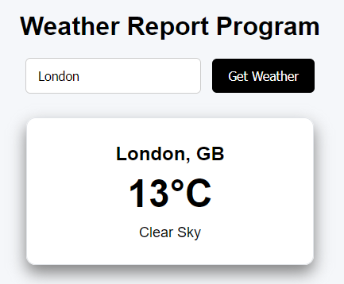

# Weather Report Spring

A small weather report web app built with [Spring Boot](https://spring.io/projects/spring-boot) and data from the [OpenWeatherMap API](https://openweathermap.org/api). Type in a location, click **Get Weather**, and a card shows the city and country code, the current temperature rounded to the nearest °C, and a short description of the weather.



## How it works

- **Backend** – a Spring Boot REST controller exposes `GET /api/weather?location=<city>`. It calls OpenWeatherMap's current weather endpoint (metric units) and maps the JSON response onto Java classes (`WeatherResponse` and the classes in the `json` package).
- **Frontend** – a static page (`index.html` + `weather.js`) served by Spring Boot that calls the API and displays the result.

## Requirements

- Java 17 or newer
- An OpenWeatherMap account and API key ([sign up here](https://home.openweathermap.org/users/sign_up))

Maven doesn't need to be installed separately; the project includes the Maven wrapper (`mvnw` / `mvnw.cmd`).

## Setup

1. Clone the repository:

   ```bash
   git clone https://github.com/haranlakha/weather-report-spring.git
   cd weather-report-spring
   ```

2. Create a file named `config.properties` in the project root (next to `pom.xml`) containing your API key:

   ```properties
   API_KEY=your_api_key_here
   ```

   Replace `your_api_key_here` with your real key. This file is listed in `.gitignore`, so your key won't be committed.

   > Instead of `config.properties` you can set an `API_KEY` environment variable. The API will return an error if the key is empty or still set to the placeholder.

## Running

From the project root:

```bash
./mvnw spring-boot:run
```

On Windows, use `mvnw.cmd spring-boot:run` instead.

You can also open the project in an IDE such as [IntelliJ IDEA](https://www.jetbrains.com/idea/) and run `WeatherReportSpringApplication`. Make sure the working directory is the project root so `config.properties` is found.

Then open <http://localhost:8080> in your browser, enter a location (e.g. `London`) and click **Get Weather**.

## API

| Method | Endpoint | Description |
| ------ | -------- | ----------- |
| `GET` | `/api/weather?location=London` | Returns the current weather for the given location |

Example:

```bash
curl "http://localhost:8080/api/weather?location=London"
```

Responses:

- `200 OK` – weather data (same shape as the OpenWeatherMap current weather response)
- `400 Bad Request` – the OpenWeatherMap request failed (e.g. unknown location)
- `500 Internal Server Error` – no API key is configured

## Building and testing

```bash
./mvnw package
```

This runs the tests and builds a runnable JAR in `target/`, which you can start with:

```bash
java -jar target/weather-report-spring-0.0.1-SNAPSHOT.jar
```

Run it from the project root so `config.properties` is picked up.

## Deploying to AWS Elastic Beanstalk

`./mvnw package` also builds a Beanstalk source bundle, `target/weather-report-spring-0.0.1-SNAPSHOT-beanstalk.zip`, containing the jar (as `application.jar`), a `Procfile` and the `.ebextensions` config. The app listens on the port in the `PORT` environment variable (8080 if unset), and `.ebextensions/options.config` sets it to 5000, which is where Beanstalk's nginx proxy forwards requests.

Using the AWS console:

1. Create an Elastic Beanstalk application and a **web server environment** on the **Java** platform (Corretto 17 or 21).
2. Under **Application code**, choose **Upload your code** and upload the `-beanstalk.zip` file.
3. Once the environment is created, go to **Configuration → Updates, monitoring, and logging → Environment properties** and add `API_KEY` with your OpenWeatherMap key.
4. Open the environment's URL.

To deploy a new version, rebuild and upload the new zip with **Upload and deploy**.

Using the [EB CLI](https://docs.aws.amazon.com/elasticbeanstalk/latest/dg/eb-cli3.html), run `eb init` (Java platform), then add the following to the generated `.elasticbeanstalk/config.yml` so it deploys the bundle:

```yaml
deploy:
  artifact: target/weather-report-spring-0.0.1-SNAPSHOT-beanstalk.zip
```

Then:

```bash
eb create weather-report-env
eb setenv API_KEY=your_api_key_here
eb deploy
```

## Project structure

```
.ebextensions/options.config              # Elastic Beanstalk environment settings
Procfile                                  # Elastic Beanstalk start command
docs/
└── screenshot.png                        # Screenshot used in this README
src/assembly/beanstalk.xml                # Builds the Beanstalk source bundle
src/main/java/com/example/weatherreportspring/
├── WeatherReportSpringApplication.java   # Spring Boot entry point
├── Controller.java                       # /api/weather endpoint
├── WeatherResponse.java                  # Maps the OpenWeatherMap response
└── json/                                 # Nested response objects (coord, main, wind, ...)
src/main/resources/
├── application.properties
└── static/
    ├── index.html                        # Frontend page
    └── weather.js                        # Calls the API and renders results
```
